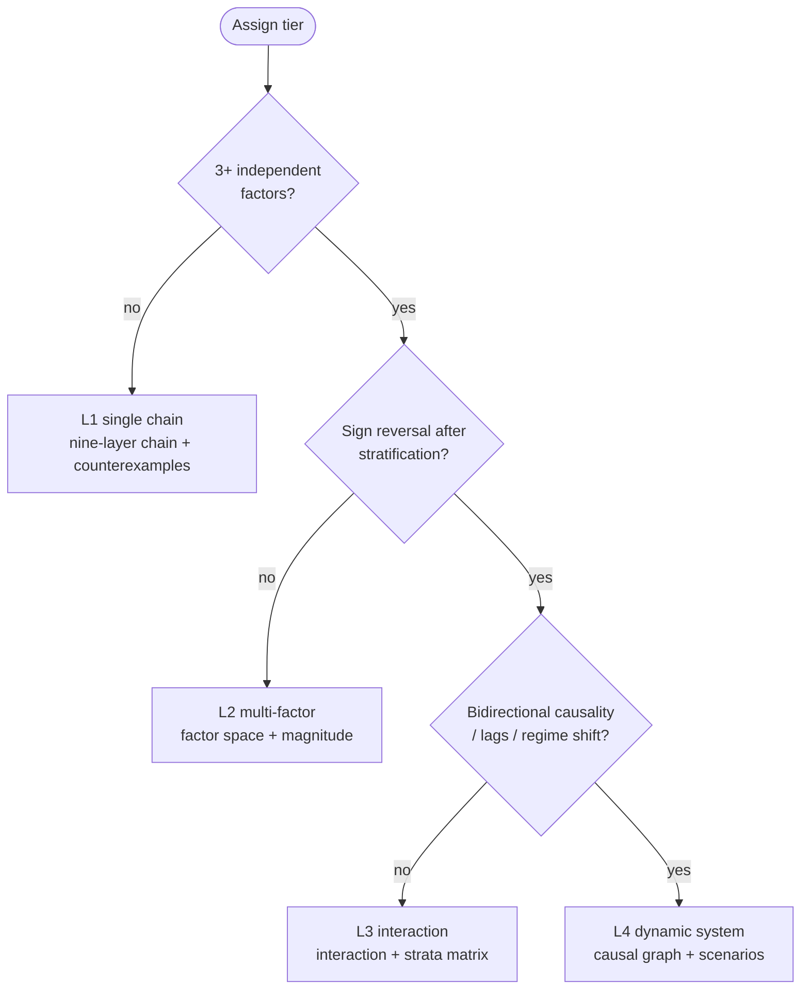
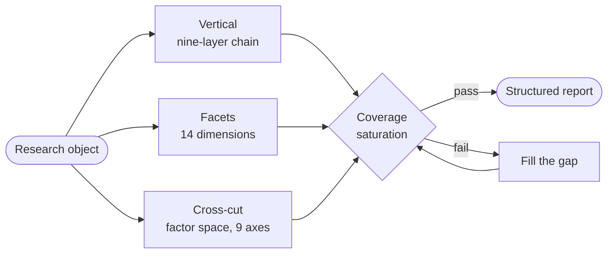
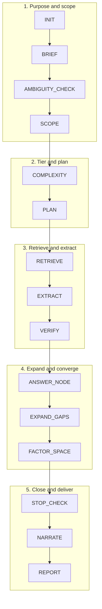

# AI-SQ Universal Root-Inquiry

<p align="center">
  <a href="README.md">简体中文</a> ·
  <b>English</b> ·
  <a href="README.ja.md">日本語</a> ·
  <a href="README.ko.md">한국어</a> ·
  <a href="README.es.md">Español</a> ·
  <a href="README.fr.md">Français</a> ·
  <a href="README.de.md">Deutsch</a>
</p>

<p align="center">
  <a href="https://github.com/Songyuanhong-nnn/Banana_RD-Skill/releases"></a>
  
  
  
  
</p>

> **One-line core**
> **Root inquiry = question tree × evidence chain × gap recursion × factor space × scope & counterexamples × level validation × coverage saturation × stopping control × structured report.**

Version **2.4.0** · English (en) · MIT · Plain text, no runtime dependencies

---

## ⚖️ First: what it is not

v2.0 claimed it "applies to every domain." That sentence violated the Skill's own 5th principle — **whenever the word "all" appears, you are obliged to look for counterexamples**. Counterexamples were readily available, so v2.1 withdrew the claim and replaced it with an honest ledger:

| Fit | Domains | Why |
|---|---|---|
| **Strong** | Scientific mechanisms, technology selection, historical sources | Conclusions rest on the primary layer, and **the falsification path is public** (replication, source code + measurement, source criticism) |
| **Medium** | Law, finance/business, policy | Strong on statutes / disclosures / document retrieval; weak on case-specific facts, internal data, counterfactuals |
| **Weak** | Clinical decisions, private-system failures, multi-agent games | The decision variables are private data about this individual or this situation; retrieval cannot reach them |
| **Not applicable** | Mathematical proof, aesthetic judgment, real-time decisions, undisclosed data | Deductive problems, no falsifiable claim, time budget too tight, evidence outside the public domain |

Full criteria, the "most misleading point" for each domain, and degradation paths are in [`references/domain_fit.md`](ai-sq-universal/references/domain_fit.md).

---

## ✅ What it guarantees — and what it does not

**Guarantees**: conclusions are traceable (ID + verbatim sentence + grade); scope is tested (true for whom, false when); **factors are enumerated** (not "one chain found, hand it in"); stopping has a reason (it distinguishes "finished" from "cannot continue").

**Does not guarantee**: actionable professional decisions; primary data; deductive conclusions; second-level answers.

---

## 🧩 Core: why three coverage mechanisms

v2.0 had only the nine-layer inquiry chain — a **vertical cut**, digging one object down a single string of questions. But real questions usually involve "many factors acting together." A vertical cut may finish having explored three chains while six other classes of factors were never even imagined.

**Depth ≠ coverage.** The vertical cut has a subtler blind spot too: it does not know "what the client will ask." So the mechanisms each own one layer:

```
Vertical:  nine-layer inquiry chain ────→ deep (one line to the bottom)
Facets:    14-dimension outline (D1–D14)→ complete (the question surfaces a decision-maker asks)
Cross-cut: factor space (9 axes + magnitude) → granular (no whole class of factors missed)
Strata:    stratification matrix ───────→ accurate (same factor reverses across contexts)
Joints:    interaction & confounding (15 patterns) → real (factors are not independent)
Acceptance: coverage saturation (6 criteria) → verifiable ("comprehensive" stops being an adjective)
Citation:  quote-level citation (locator + verbatim) → checkable (every conclusion re-checkable in 30 seconds)
```

### 1. 📐 Complexity tiers L1–L4: set the tier first, then decide how much to expand

| Tier | Structural criterion | Mandatory checks |
|---|---|---|
| **L1 single chain** | One dominant cause → one main effect, and stratification/interaction checks found no sign reversal | Nine-layer chain + counterexamples; no factor space |
| **L2 multi-factor** | ≥3 relatively independent factors, and checks found no sign reversal | Factor space + magnitude + preliminary collinearity/confounding check |
| **L3 interaction/heterogeneity** | Sign reversal after stratification, non-additive joint effects, thresholds/non-linearity, mechanisms differ across cases | L2 + interaction matrix + stratification matrix |
| **L4 dynamic system** | Bidirectional edges in the causal graph, bidirectional temporal evidence, known lags, regime shifts | L3 + causal graph + lags + scenario analysis + three model-limitation fields |

Of the five hard rules, two matter most:

- **Tier is orthogonal to factor count**: many factors but all linear = L2; few factors but strong feedback = L4. Do not confuse "many factors" with "complex."
- **Tier ≠ completeness**: the tier decides "which checks are mandatory"; the budget decides "how many get done this time." Insufficient budget **does not lower the tier** — mark unfinished items `unchecked`. Lowering the tier quietly turns "not checked" into "did not need checking."

One more rule against self-deception: **"no sign reversal found" is not "no sign reversal exists."** Without stratification/interaction checks you have no right to assign L1/L2 — treat it as one tier higher and leave a trace in `gaps`.



### 2. 🧮 Factor space: enumerate by axis, never from memory

Walk all nine axes mechanically. Each axis either has factors or says "empty, reason given." A blank and a confirmed absence are two different things.

| Axis | What gets missed most |
|---|---|
| Time | Cross-sectional data treated as causal; lags invisible |
| Space/level | Ecological fallacy (group conclusion applied to individuals) |
| Agent | Counting only objective factors, missing "who decides" |
| Matter/resources | Treating resource constraints as "all else equal" |
| Rules/institutions | Ignoring institutional change that reverses effects |
| Information/cognition | Assuming a fully informed, rational agent |
| Technology/tools | Ignoring generational differences in technology |
| Environment/external shocks | Writing a one-off shock as a structural cause |
| Feedback/dynamics | Static frameworks cannot see dynamics |

Every factor must carry `role` (necessary/promoting/threshold/modifying/confounding), `direction`, **`magnitude`**, `magnitude_basis`, `proxy`, and `how_to_test`.

**Magnitude is mandatory**: `dominant` / `major` / `minor` / `unknown` (unknown must state why). "All the above factors are important and must be considered together" is banned — that sentence carries zero information.

### 3. 🔗 Interaction and confounding: 15 patterns you must actively compare

See [`references/complexity_patterns.md`](ai-sq-universal/references/complexity_patterns.md): confounding, mediation, effect modification, interaction, collider, Simpson's paradox, ecological fallacy, threshold, feedback, lag, path dependence, equifinality, proxy error, selection bias, phase transition. Each entry covers "how to spot it / what to ask / search cues / common misjudgments."

Output must contain `checked-none` — **otherwise readers cannot tell "checked and found none" from "never checked."**

### 4. 🎯 Coverage saturation: making "comprehensive" auditable

Six criteria in report §14; missing one forfeits the phrase "systematically covered":

1. **Axis coverage**: all 9 axes walked, empty axes justified
2. **Magnitude coverage**: every factor has a magnitude; unknown has a reason
3. **Saturation**: two consecutive rounds with no new factors and no new axes
4. **Negative space**: list factors that "by common sense should exist, but I did not find" ← **the biggest holes usually live here**
5. **Interaction check**: pairwise interactions among dominant/major factors examined
6. **Stratification check**: whether ≥2 key strata reverse

### 5. 🧭 Dimension outline: 14 question surfaces (the third coverage)

The first two mechanisms govern "how deep is a single question" and "what factor types does a single outcome have." Neither can govern "**which surfaces should this study answer**." An investor asks about market, an engineer about performance headroom, procurement about TCO, legal about compliance boundaries — miss one, and the report is incomplete in the eyes of one class of reader.

| # | Dimension | # | Dimension |
|---|---|---|---|
| D1 | Goal and decision context | D8 | Policy, regulation, standards |
| D2 | Definitions, boundaries, conventions | D9 | Agents, incentives, procurement chain |
| D3 | Performance and technical capability | D10 | Timing, phases, roadmap |
| D4 | Economics (TCO) | D11 | Risk, failure modes, counterexamples |
| D5 | Market and demand | D12 | Evidence quality and controversy |
| D6 | Competition and peers | D13 | Decision implications and alternatives |
| D7 | Supply chain, capacity, delivery | D14 | Open questions, negative space, next steps |

Each dimension supplies: must-answer questions / required material / **typical difficulties (branches grow from here)** / minimum evidence / when to rule unknown. Activate mandatory dimensions by object type; **any dimension not activated must state "why not selected."**

**Four rounds of gap hunting** (literally "repeatedly checking for omissions"): R1 dimension level → R2 factor level → R3 counterexample level (including a dedicated pass on exits and failures) → R4 negative-space level. Saturation requires two consecutive rounds with zero additions.

See [`references/dimension_outline.md`](ai-sq-universal/references/dimension_outline.md).

### 6. 🔍 Quote-level citation: the smallest verifiable unit of evidence

"Has a source" is not enough. The most evidence-like and least reliable part of any report is the reference list — **a fabricated quotation reads exactly like a real one; the only difference is that it cannot be located**.

Every key conclusion must supply: **locator** (page/paragraph/clause/table row/timestamp) + **verbatim sentence** + context + source entity and publication date + traceability chain.

Four hard rules:

1. **Must reach the sentence**: a bare link, a report title, or "some WeChat account" is automatically disqualified.
2. **Second-hand sources graded by their weakest link**: a WeChat account relaying a paper = graded C/D as a WeChat account, and **you must attempt to trace back to the primary source**.
3. **WeChat accounts are leads only**; departmental documents must give **document number + clause number + effective date** (and be checked for current validity).
4. **Context guards against truncation**: the original being a negation, being an example used to refute, or reporting someone else's view — these three are the easiest ways to cite something as its opposite.

Sources with no "sentence": databases are located by "database + field + period + convention"; interviews/internal documents are marked `unverified` and never enter key conclusions; paywalled sources cite only pages actually read.

See [`schemas/citation.json`](ai-sq-universal/schemas/citation.json) and [`prompts/citation_auditor.md`](ai-sq-universal/prompts/citation_auditor.md).

---



## 🗂️ Repository layout

```text
AI-SQ-Universal-Root-Inquiry/
├── README.md                  This file (Chinese)
├── README.{en,ja,ko,es,fr,de}.md   Translations
├── INSTALL.md                 Install / verify / troubleshoot / uninstall
├── CHANGELOG.md    VERSION    LICENSE
├── ai-sq-universal/           ← The Skill itself (can go straight into ~/.dsh/skills/)
│   ├── SKILL.md               Main spec: vertical+horizontal, tiers, saturation, quality gate
│   ├── prompts/               9 execution prompts
│   │   ├── briefer.md         Five purpose questions + five stakeholder classes (BRIEF) ★ v2.4
│   │   ├── planner.md         Question-tree planning
│   │   ├── factor_mapper.md   Factor space (axis enumeration + magnitude) ★ v2.1
│   │   ├── citation_auditor.md Citation audit (locator/verbatim/context/primary) ★ v2.2
│   │   ├── question_generator.md  Gap follow-up
│   │   ├── extractor.md       Evidence extraction
│   │   ├── verifier.md        Verification + interaction/confounding/strata
│   │   ├── narrator.md        Narrative assembly (SCQA, first sentence of each section is a judgment) ★ v2.4
│   │   └── reporter.md        Report generation
│   ├── schemas/               6 contracts
│   │   ├── question_node.json  evidence.json
│   │   ├── factor.json        Factor object ★ v2.1
│   │   ├── citation.json      Quote-level citation ★ v2.2
│   │   ├── report.json        Includes brief / scope_expansion / factor_space / interactions / strata / coverage
│   │   └── domain_pack.json   Domain-pack interface
│   ├── references/            5 reference specs
│   │   ├── dimension_outline.md    14 dimensions + four rounds of gap hunting ★ v2.2
│   │   ├── complexity_patterns.md  15 multi-factor patterns + L1–L4 criteria + 9-axis self-check
│   │   ├── domain_fit.md           Domain fit matrix (strong/medium/weak/not applicable)
│   │   ├── omissions_audit.md      Two adversarial omission audits ★ v2.2
│   │   └── brief_and_stakeholders.md Purpose/stakeholders/scope/narrative/traceability ★ v2.4
│   ├── domain_packs/          7 domain packs + adapter notes
│   │   └── science.yaml       Includes sub_packs.bacteriology
│   ├── templates/report.md    §0 + fourteen sections (§1–§14) report template
│   ├── evals/cases.yaml       13 cross-domain cases (2 hard L3 + 1 citation case)
│   ├── examples/              5 examples: full report / ambiguity / no-answer / industry path / equipment path
│   └── scripts/               validate.py  quality_gate.py  build_docx.py
├── docs/                      ← GitHub Pages landing page (Chinese)
├── plugin/                    Manifest + Cordis patch + cross-platform installers
└── tools/build_release.py     Reproducible packaging
```

---

## 🚀 Quick start

```powershell
cd plugin
.\install.ps1                 # Windows, copy mode, no config changes needed
```

```bash
cd plugin && ./install.sh     # macOS / Linux
```

Then just state your need:

> Root-inquiry into the pathogenicity of O157:H7: **what factors matter**, how strong is each, and do all strains cause disease?

> Same environmental production-cap policy — why did province A improve markedly while province B saw almost no effect? Break out the factors and their interactions.

> Dig into this clause conflict: which applies, the general law or the special law, and are there exceptions?

Quantifier questions get disambiguated first ("how many paragraphs does this contract have").

Self-check:

```bash
python ai-sq-universal/scripts/validate.py
```

---

## ⚙️ Pipeline (thirteen steps)

```
INIT → BRIEF → AMBIGUITY_CHECK → SCOPE → COMPLEXITY → PLAN → RETRIEVE → EXTRACT
     → VERIFY → ANSWER_NODE → EXPAND_GAPS → FACTOR_SPACE → STOP_CHECK → NARRATE → REPORT
```

| Step | What it prevents |
|---|---|
| INIT | Wrong target |
| **BRIEF** | **Precise but useless: nobody can act on it** (five purpose questions + five stakeholder classes) |
| AMBIGUITY_CHECK | Answering "how many paragraphs" on the wrong dimension |
| **SCOPE** | **Answering only what was asked, missing the variables that decide success** (scope-expansion audit) |
| **COMPLEXITY** | Over-expanding simple questions / skimming complex ones |
| PLAN | Vague questions |
| RETRIEVE | Treating an encyclopedia as a conclusion |
| EXTRACT | Conclusion strength silently inflated (`quote` must be verbatim) |
| VERIFY | Applying category claims to instances; correlation as causation |
| EXPAND_GAPS | Endless follow-up (one question per gap, ≤5, deduplicated) |
| **FACTOR_SPACE** | **Handing in after digging a single chain** |
| **STOP_CHECK** | Disguising "not finished" as "finished" |
| **NARRATE** | Sections opening with "the table below shows…" so nobody knows the conclusion |
| REPORT | Not re-checkable |

---



## 📊 Evidence grades (hard constraint)

| Grade | Meaning | Use |
|---|---|---|
| **A** | Authoritative databases/standards/regulations/guidelines/official statistics + high-quality systematic reviews, multiple sources agreeing | Supports key conclusions |
| **B** | Peer-reviewed primary research, authoritative institutional reports | Supports conclusions |
| **C** | Preprints, industry reports, single studies, automated annotation | **Leads only** |
| **D** | Encyclopedias, news, unverified web pages | **Never for key conclusions** |

Domain packs may **refine** these grades but may not downgrade them wholesale. No ID means downgrade plus an `id_missing` flag — a fabricated ID is worse than no ID.

---

## 🛑 Stopping rules

Node level, nine conditions (evidence closure / two rounds with no new information / low marginal gain / budget / only C–D left / irreconcilable conflict / high risk requiring review / beyond retrieval scope / ambiguity unresolved).
Global: all high-priority nodes closed **and** the six coverage criteria met, or budget exhausted with gaps documented.

**Every stop writes a `stop_reason`.**

---

## 📄 Report: §0 + fourteen sections (§1–§14), delivered as Word

Authoring happens in Markdown (models edit it easily); **delivery is Word** (readers need to open it). `scripts/build_docx.py` renders the same markdown into a docx: cover, TOC, header/footer, zebra-striped tables, clickable citations; plus JSON for machine checks. **Never hand-save as Word** — that is the root cause of documents drifting away from their conclusions. Since v2.4 the report opens with **§0 Purpose and Stakeholders**, and adds §14 Coverage and Saturation Statement — without it, "comprehensive" is just an adjective.

Template at `templates/report.md`; a filled example at [`examples/01-bacteriology.md`](ai-sq-universal/examples/01-bacteriology.md) (includes a factor-space table and an honest "coverage incomplete" statement).

---

## 🚦 Quality gate

```bash
python ai-sq-universal/scripts/quality_gate.py report.md --json report.json --complexity 3 --risk high
```

Checks scale with complexity: L2 checks factors and magnitudes; L3 checks interactions/strata/`checked-none`; L4 checks feedback and model limitations. It also checks all fourteen sections, traceability rate, **parseable citation-locator rate**, **verbatim sentence column**, **vague-attribution interception**, **media may not be graded A/B**, sampling-verification records, absolute wording, stop reasons, disclaimers, and negative space. Outputs PASS/FAIL with an exit code, CI-ready.

---

## 🧪 Evaluation

13 cases spanning science, law, finance, history, technology, policy, business, ambiguous objects, unanswerable questions, and high-risk questions — including **two hard L3 multi-factor cases** (same policy, opposite outcomes in two regions; same strain, different outcomes) and a **quote-level citation case** (verifying a second-hand number from a WeChat account and tracing it back to the primary source). Each case carries `probes` / `must_show` / `must_not` / `expected_stop` / `complexity`; any `must_not` hit scores zero.

---

## 🏛️ Design principles (twelve)

1. Domain-agnostic kernel + domain adapter packs — the kernel hard-codes no domain terminology
2. **Set the complexity tier before deciding depth** — prevents boilerplate and carelessness
3. **Vertical for depth, horizontal for coverage** — nine-layer chain + factor space, both required
4. Gap-driven — chase only information gaps, never repeat a question
5. Evidence first — key conclusions need a source, a verbatim sentence, an ID, a grade
6. Scope bounding — global/class/instance/condition/time/geography
7. Counterexample check — when "all / every / always / only" appears, look for counterexamples
8. Level validation — never treat a carrier as an element, a product as a cause, or a category property as an instance property
9. Disambiguate first — clarify or declare assumptions
10. **Coverage auditable** — six criteria; missing one means saying "coverage incomplete"
11. Human review for high risk — medicine/law/finance/security/policy/psychology
12. Dual output — JSON + Markdown

---

## ⚠️ Failure modes and countermeasures

| Failure mode | Countermeasure |
|---|---|
| Endless follow-up | Budget + dedup key + marginal-gain stop |
| **Digging a single chain** | Complexity tiering + factor space + axis enumeration |
| **Undifferentiated factor list** | Mandatory `magnitude` + `magnitude_basis` |
| **Average effects masking reverse subgroups** | Stratification matrix + effect modification |
| **Correlation treated as causation** | Confounding/mediation/collider checks |
| **Fake comprehensiveness** | §14 six criteria + negative space |
| Fabricated IDs | Downgrade when no ID; never guess IDs |
| Category conclusions applied to instances | `scope` + counterexamples |
| Carrier/element/product confusion | `entity_levels` validation |
| Wrong reading of "how many paragraphs" | `structure_semantics` disambiguation |
| Web pages only | Source priority + evidence grades |
| Conflicts smoothed over | Preserve disagreement, list a conflict table |
| High-risk misleading | Disclaimer + human review |

---

## 🚧 Boundaries

- No real-time quotes/weather/scores.
- Does not replace professional judgment: medicine/law/finance outputs are **information organization**, not diagnosis, legal, or investment advice.
- Does not provide executable detail usable for real-world harm (pathogen enhancement, detection evasion, weaponization, etc.).
- **"Not found" ≠ "does not exist"** — reports distinguish the two.
- Deductive problems (mathematical proof, code derivation), aesthetic judgment, primary experiments, internal data: not suitable. See `references/domain_fit.md`.

---

## 📚 Documentation

- [INSTALL.md](INSTALL.md) — install / verify / troubleshoot / uninstall
- [ai-sq-universal/SKILL.md](ai-sq-universal/SKILL.md) — full main specification
- [references/domain_fit.md](ai-sq-universal/references/domain_fit.md) — whether you should use this at all
- [references/complexity_patterns.md](ai-sq-universal/references/complexity_patterns.md) — multi-factor pattern quick reference
- [domain_packs/README.md](ai-sq-universal/domain_packs/README.md) — adding a domain pack
- [plugin/README.md](plugin/README.md) — plugin layer and install routing
- [CHANGELOG.md](CHANGELOG.md) — version history
