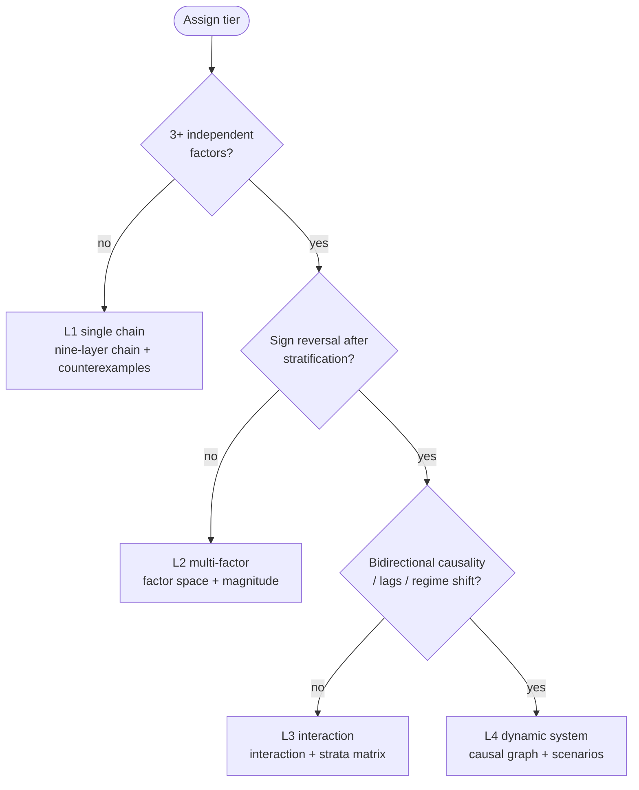
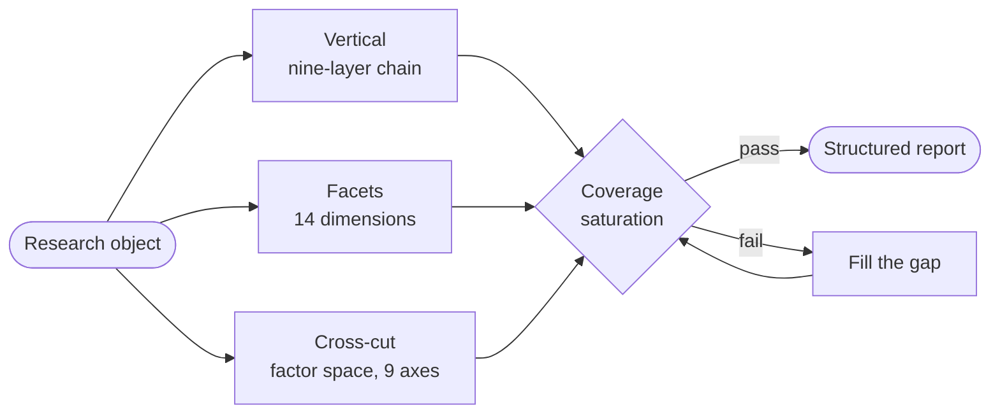
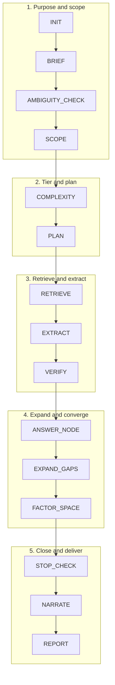

# AI-SQ Universal Root-Inquiry / Indagación radical universal

<p align="center">
  <a href="README.md">简体中文</a> ·
  <a href="README.en.md">English</a> ·
  <a href="README.ja.md">日本語</a> ·
  <a href="README.ko.md">한국어</a> ·
  <b>Español</b> ·
  <a href="README.fr.md">Français</a> ·
  <a href="README.de.md">Deutsch</a>
</p>

<p align="center">
  <a href="https://github.com/Songyuanhong-nnn/Banana_RD-Skill/releases"></a>
  
  
  
  
</p>

> **Núcleo en una línea**
> **Indagación radical = árbol de preguntas × cadena de evidencia × recursión de vacíos × espacio de factores × alcance y contraejemplos × validación de niveles × saturación de cobertura × control de parada × informe estructurado.**

Versión **2.4.0** · Español (es) · MIT · Texto plano, sin dependencias de ejecución

---

## ⚖️ Primero, lo que no es

La v2.0 afirmaba que «se aplica a todos los dominios». Esa frase violaba el quinto principio del propio Skill — **cuando aparece la palabra «todos», estás obligado a buscar contraejemplos**. Los contraejemplos aparecieron de inmediato, así que la v2.1 retiró la afirmación y la sustituyó por un balance honesto:

| Ajuste | Dominios | Por qué |
|---|---|---|
| **Fuerte** | Mecanismos científicos, selección tecnológica, fuentes históricas | Las conclusiones se apoyan en la capa primaria y **la ruta de falsación es pública** (réplica, código fuente + medición, crítica de fuentes) |
| **Medio** | Derecho, finanzas/negocio, políticas públicas | Fuerte en textos legales, divulgaciones y recuperación documental; débil en hechos del caso concreto, datos internos y contrafactuales |
| **Débil** | Decisiones clínicas, fallos de sistemas privados, juegos multiagente | Las variables de decisión son datos privados de este individuo o de esta situación; la búsqueda no llega a ellos |
| **No aplicable** | Demostración matemática, juicio estético, decisiones en tiempo real, datos no divulgados | Problemas deductivos, sin afirmación falsable, presupuesto de tiempo insuficiente, evidencia fuera del dominio público |

Criterios completos, el «punto más engañoso» de cada dominio y las rutas de degradación están en [`references/domain_fit.md`](ai-sq-universal/references/domain_fit.md).

---

## ✅ Qué garantiza y qué no

**Garantiza**: conclusiones rastreables (ID + frase textual + grado); alcance comprobado (para quién es válido, cuándo no lo es); **factores enumerados** (no «encontré una cadena y entrego»); la parada tiene motivo (distingue «terminé» de «no puedo seguir»).

**No garantiza**: decisiones profesionales ejecutables; datos primarios; conclusiones deductivas; respuestas en segundos.

---

## 🧩 Núcleo: por qué hacen falta tres mecanismos de cobertura

La v2.0 solo tenía la cadena de nueve capas, que es un **corte vertical**: excavar un objeto hacia abajo siguiendo una sola hebra de preguntas. Pero los problemas reales suelen implicar «muchos factores actuando a la vez». Un corte vertical puede terminar habiendo explorado tres cadenas mientras otras seis clases de factores nunca fueron siquiera imaginadas.

**Profundidad ≠ cobertura.** El corte vertical tiene además un punto ciego más sutil: no sabe «qué va a preguntar el cliente». Por eso cada mecanismo se ocupa de una capa:

```
Vertical:   cadena de nueve capas ─────→ profundo (una línea hasta el fondo)
Facetas:    esquema de 14 dimensiones (D1–D14) → completo (las superficies que pregunta quien decide)
Transversal: espacio de factores (9 ejes + magnitud) → granular (ninguna clase entera de factores omitida)
Estratos:   matriz de estratificación ─→ preciso (el mismo factor se invierte según el contexto)
Articulación: interacción y confusión (15 patrones) → real (los factores no son independientes)
Aceptación: saturación de cobertura (6 criterios) → verificable («exhaustivo» deja de ser un adjetivo)
Citación:   cita a nivel de frase (ubicación + textual) → comprobable (cada conclusión revisable en 30 segundos)
```

### 1. 📐 Niveles de complejidad L1–L4: fijar el nivel antes de decidir cuánto expandir

| Nivel | Criterio estructural | Comprobaciones obligatorias |
|---|---|---|
| **L1 cadena única** | Una causa dominante → un efecto principal, y la estratificación/interacción no halló inversión de signo | Cadena de nueve capas + contraejemplos; sin espacio de factores |
| **L2 multifactor** | ≥3 factores relativamente independientes, sin inversión de signo | Espacio de factores + magnitud + comprobación inicial de colinealidad/confusión |
| **L3 interacción/heterogeneidad** | Inversión de signo tras estratificar, efectos conjuntos no aditivos, umbrales/no linealidad, mecanismos distintos entre casos | L2 + matriz de interacción + matriz de estratificación |
| **L4 sistema dinámico** | Aristas bidireccionales en el grafo causal, evidencia temporal bidireccional, retardos conocidos, cambios de régimen | L3 + grafo causal + retardos + análisis de escenarios + tres campos de limitación del modelo |

De las cinco reglas duras, dos son las clave:

- **El nivel es ortogonal al número de factores**: muchos factores pero todos lineales = L2; pocos factores pero con retroalimentación fuerte = L4. No confundas «muchos factores» con «complejo».
- **Nivel ≠ grado de avance**: el nivel decide «qué comprobaciones son obligatorias»; el presupuesto decide «cuántas se completan esta vez». Si el presupuesto no alcanza, **no se baja el nivel**: marca lo pendiente como `unchecked`. Bajar el nivel convierte en silencio «no lo comprobé» en «no hacía falta comprobarlo».

Otra regla contra el autoengaño: **«no encontré inversión de signo» no es «no hay inversión de signo»**. Sin comprobaciones de estratificación/interacción no tienes derecho a asignar L1/L2: trátalo como un nivel superior y deja constancia en `gaps`.



### 2. 🧮 Espacio de factores: enumerar por eje, nunca de memoria

Recorre los nueve ejes mecánicamente. Cada eje o tiene factores, o dice «vacío, con motivo». Un hueco en blanco y una ausencia confirmada son cosas distintas.

| Eje | Lo que más se omite |
|---|---|
| Tiempo | Datos transversales tratados como causales; retardos invisibles |
| Espacio/nivel | Falacia ecológica (conclusión de grupo aplicada a individuos) |
| Agente | Contar solo factores objetivos, omitir «quién decide» |
| Materia/recursos | Tratar la restricción de recursos como «todo lo demás constante» |
| Reglas/instituciones | Ignorar cambios institucionales que invierten los efectos |
| Información/cognición | Suponer un agente plenamente informado y racional |
| Tecnología/herramientas | Ignorar diferencias generacionales de la tecnología |
| Entorno/choques externos | Escribir un choque puntual como causa estructural |
| Retroalimentación/dinámica | Los marcos estáticos no ven la dinámica |

Cada factor debe llevar `role` (necesario/promotor/umbral/modificador/confusor), `direction`, **`magnitude`**, `magnitude_basis`, `proxy` y `how_to_test`.

**La magnitud es obligatoria**: `dominant` / `major` / `minor` / `unknown` (unknown debe explicar por qué). Está prohibido «todos los factores anteriores son importantes y deben considerarse en conjunto»: esa frase tiene cero información.

### 3. 🔗 Interacción y confusión: 15 patrones que debes comparar activamente

Ver [`references/complexity_patterns.md`](ai-sq-universal/references/complexity_patterns.md): confusión, mediación, modificación del efecto, interacción, colisionador, paradoja de Simpson, falacia ecológica, umbral, retroalimentación, retardo, dependencia de la trayectoria, equifinalidad, error de proxy, sesgo de selección, transición de fase. Cada entrada incluye «cómo detectarlo / qué preguntar / pistas de búsqueda / errores frecuentes».

La salida debe contener `checked-none` — **de lo contrario el lector no puede distinguir «lo comprobé y no había» de «nunca lo comprobé»**.

### 4. 🎯 Saturación de cobertura: hacer «exhaustivo» auditable

Seis criterios en el §14 del informe; si falta uno, no puedes decir «cobertura sistemática»:

1. **Cobertura de ejes**: los 9 ejes recorridos, los vacíos justificados
2. **Cobertura de magnitud**: cada factor tiene magnitud; unknown tiene motivo
3. **Saturación**: dos rondas consecutivas sin factores ni ejes nuevos
4. **Espacio negativo**: enumerar factores que «por sentido común deberían existir pero no encontré» ← **los mayores agujeros suelen estar aquí**
5. **Comprobación de interacción**: pares de factores dominant/major revisados
6. **Comprobación de estratificación**: si ≥2 estratos clave se invierten

### 5. 🧭 Esquema de dimensiones: 14 superficies de pregunta (la tercera cobertura)

Los dos primeros mecanismos gobiernan «cuán profunda es una pregunta» y «qué tipos de factores tiene un resultado». Ninguno gobierna «**qué superficies debe responder este estudio**». El inversor pregunta por el mercado, el ingeniero por el margen de rendimiento, compras por el TCO, legal por los límites de cumplimiento: si falta una, el informe queda incompleto ante una clase de lector.

| # | Dimensión | # | Dimensión |
|---|---|---|---|
| D1 | Objetivo y contexto de decisión | D8 | Política, regulación, normas |
| D2 | Definiciones, límites, criterios | D9 | Agentes, incentivos, cadena de compra |
| D3 | Rendimiento y capacidad técnica | D10 | Tiempo, fases, hoja de ruta |
| D4 | Economía (TCO) | D11 | Riesgo, modos de fallo, contraejemplos |
| D5 | Mercado y demanda | D12 | Calidad de la evidencia y controversia |
| D6 | Competencia y pares | D13 | Implicaciones y alternativas |
| D7 | Cadena de suministro, capacidad, entrega | D14 | Cuestiones abiertas, espacio negativo, siguientes pasos |

Cada dimensión aporta: preguntas obligatorias / material necesario / **dificultades típicas (aquí nacen las ramas)** / evidencia mínima / cuándo declarar unknown. Activa las dimensiones obligatorias según el tipo de objeto; **toda dimensión no activada debe declarar «por qué no se selecciona»**.

**Cuatro rondas de búsqueda de omisiones**: R1 nivel de dimensión → R2 nivel de factor → R3 nivel de contraejemplo (con pasada específica sobre salidas y fracasos) → R4 nivel de espacio negativo. Hay saturación cuando dos rondas consecutivas no añaden nada.

Ver [`references/dimension_outline.md`](ai-sq-universal/references/dimension_outline.md).

### 6. 🔍 Cita a nivel de frase: la unidad mínima verificable de evidencia

«Tiene fuente» no basta. La parte más parecida a evidencia y menos fiable de un informe es la lista de referencias: **una cita fabricada se lee exactamente igual que una real; la única diferencia es que no se puede localizar**.

Toda conclusión clave debe aportar: **ubicación** (página/párrafo/cláusula/fila de tabla/marca de tiempo) + **frase textual** + contexto + entidad fuente y fecha de publicación + cadena de trazabilidad.

Cuatro reglas duras:

1. **Debe llegar a la frase**: un enlace suelto, un título de informe o «cierta cuenta de WeChat» quedan descalificados.
2. **Las fuentes secundarias se gradúan por su eslabón más débil**: una cuenta de WeChat que relata un artículo = se gradúa como cuenta de WeChat en C/D, y **debes intentar remontarte a la fuente primaria**.
3. **Las cuentas de WeChat son solo pistas**; los documentos departamentales deben dar **número de documento + número de cláusula + fecha de entrada en vigor** (y comprobar su vigencia actual).
4. **El contexto evita el truncamiento**: que el original sea una negación, un ejemplo usado para refutar, o la opinión de un tercero: estas tres son las formas más fáciles de citar algo como su contrario.

Fuentes sin «frase»: las bases de datos se ubican por «base + campo + período + criterio»; entrevistas/documentos internos se marcan `unverified` y no entran en conclusiones clave; los muros de pago solo citan páginas realmente leídas.

Ver [`schemas/citation.json`](ai-sq-universal/schemas/citation.json) y [`prompts/citation_auditor.md`](ai-sq-universal/prompts/citation_auditor.md).

---



## 🗂️ Estructura del repositorio

```text
AI-SQ-Universal-Root-Inquiry/
├── README.md                  Este archivo (chino)
├── README.{en,ja,ko,es,fr,de}.md  Traducciones
├── INSTALL.md                 Instalación / verificación / diagnóstico / desinstalación
├── CHANGELOG.md    VERSION    LICENSE
├── ai-sq-universal/           ← El Skill en sí (puede ir directo a ~/.dsh/skills/)
│   ├── SKILL.md               Especificación principal: vertical+horizontal, niveles, saturación, control de calidad
│   ├── prompts/               9 prompts de ejecución
│   ├── schemas/               6 contratos
│   ├── references/            5 especificaciones de referencia
│   ├── domain_packs/          7 paquetes de dominio + notas de adaptador
│   ├── templates/report.md    Plantilla §0 + catorce secciones (§1–§14)
│   ├── evals/cases.yaml       13 casos transversales de dominio
│   ├── examples/              5 ejemplos
│   └── scripts/               validate.py  quality_gate.py  build_docx.py
├── docs/                      ← Página de aterrizaje de GitHub Pages (chino)
├── plugin/                    Manifiesto + parche Cordis + instaladores multiplataforma
└── tools/build_release.py     Empaquetado reproducible
```

---

## 🚀 Inicio rápido

```powershell
cd plugin
.\install.ps1                 # Windows, modo copy, sin cambios de configuración
```

```bash
cd plugin && ./install.sh     # macOS / Linux
```

Luego plantea tu necesidad tal cual:

> Indagación radical sobre la patogenicidad de O157:H7: **qué factores influyen**, cuán fuerte es cada uno, y si todas las cepas causan enfermedad

> La misma política de restricción ambiental: ¿por qué la provincia A mejoró notablemente y la B casi no tuvo efecto? Descompón los factores y sus interacciones

> Profundiza en este conflicto de cláusulas: ¿cuál aplica, la ley general o la especial, y hay excepciones?

Las preguntas con cuantificadores se desambiguan primero («cuántos párrafos tiene este contrato»).

Autocomprobación:

```bash
python ai-sq-universal/scripts/validate.py
```

---

## ⚙️ Flujo de ejecución (trece pasos)

```
INIT → BRIEF → AMBIGUITY_CHECK → SCOPE → COMPLEXITY → PLAN → RETRIEVE → EXTRACT
     → VERIFY → ANSWER_NODE → EXPAND_GAPS → FACTOR_SPACE → STOP_CHECK → NARRATE → REPORT
```

| Paso | Qué evita |
|---|---|
| INIT | Objetivo equivocado |
| **BRIEF** | **Preciso pero inútil: nadie puede actuar sobre ello** (cinco preguntas de propósito + cinco clases de interesados) |
| AMBIGUITY_CHECK | Responder «cuántos párrafos» en la dimensión equivocada |
| **SCOPE** | **Responder solo lo preguntado, omitiendo las variables que deciden el éxito** (auditoría de expansión del alcance) |
| **COMPLEXITY** | Sobreexpandir preguntas simples / despachar preguntas complejas |
| PLAN | Preguntas vagas |
| RETRIEVE | Tomar una enciclopedia como conclusión |
| EXTRACT | Inflar en silencio la fuerza de la conclusión (`quote` debe ser textual) |
| VERIFY | Aplicar categorías a instancias; correlación como causalidad |
| EXPAND_GAPS | Seguimiento infinito (una pregunta por vacío, ≤5, sin duplicados) |
| **FACTOR_SPACE** | **Entregar tras excavar una sola cadena** |
| **STOP_CHECK** | Disfrazar «no terminé» de «terminado» |
| **NARRATE** | Secciones que abren con «la tabla siguiente muestra…» y nadie sabe la conclusión |
| REPORT | No verificable |

---



## 📊 Grados de evidencia (restricción dura)

| Grado | Significado | Uso |
|---|---|---|
| **A** | Bases autorizadas/normas/regulación/guías/estadísticas oficiales + revisiones sistemáticas de alta calidad, múltiples fuentes concordantes | Sostiene conclusiones clave |
| **B** | Investigación primaria revisada por pares, informes de instituciones autorizadas | Sostiene conclusiones |
| **C** | Preprints, informes sectoriales, estudios únicos, anotación automática | **Solo pistas** |
| **D** | Enciclopedias, noticias, páginas web no verificadas | **Nunca para conclusiones clave** |

Los paquetes de dominio pueden **refinar** los grados, pero no degradarlos en bloque. Sin ID hay degradación y marca `id_missing`: un ID fabricado es peor que ninguno.

---

## 🛑 Reglas de parada

A nivel de nodo, nueve condiciones (cierre de evidencia / dos rondas sin información nueva / ganancia marginal baja / presupuesto / solo quedan C–D / conflicto irreconciliable / alto riesgo que exige revisión / fuera del alcance de búsqueda / ambigüedad no resuelta).
Global: todos los nodos de alta prioridad cerrados **y** los seis criterios de cobertura cumplidos, o presupuesto agotado con los vacíos documentados.

**Cada parada escribe un `stop_reason`.**

---

## 📄 Informe: §0 + catorce secciones (§1–§14), entregado en Word

La escritura ocurre en Markdown (los modelos lo editan fácil); **la entrega es Word** (el lector necesita abrirlo). `scripts/build_docx.py` convierte el mismo markdown en docx: portada, índice, encabezado/pie, tablas con franjas, citas clicables; además genera JSON para comprobaciones automáticas. **Nunca guardes a mano como Word**: esa es la raíz de que el documento se separe de sus conclusiones. Desde la v2.4 el informe abre con **§0 Propósito e interesados** y añade el §14 Declaración de cobertura y saturación: sin él, «exhaustivo» es solo un adjetivo.

Plantilla en `templates/report.md`; ejemplo completo en [`examples/01-bacteriology.md`](ai-sq-universal/examples/01-bacteriology.md) (incluye tabla de espacio de factores y una declaración honesta de «cobertura incompleta»).

---

## 🚦 Control de calidad

```bash
python ai-sq-universal/scripts/quality_gate.py report.md --json report.json --complexity 3 --risk high
```

Las comprobaciones escalan con la complejidad: L2 revisa factores y magnitudes; L3 revisa interacciones/estratos/`checked-none`; L4 revisa retroalimentación y limitaciones del modelo. También verifica las catorce secciones, la tasa de trazabilidad, **la tasa de ubicaciones de cita analizables**, **la columna de frases textuales**, **la intercepción de atribuciones vagas**, **que los medios no se gradúen A/B**, los registros de verificación por muestreo, el lenguaje absoluto, los motivos de parada, los descargos y el espacio negativo. Devuelve PASS/FAIL con código de salida, listo para CI.

---

## 🧪 Evaluación

13 casos que cubren ciencia, derecho, finanzas, historia, tecnología, política, negocio, objetos ambiguos, preguntas sin respuesta y preguntas de alto riesgo, incluidos **dos casos L3 multifactor difíciles** (misma política con resultados opuestos en dos regiones; misma cepa con desenlaces distintos) y un **caso difícil de cita a nivel de frase** (verificar un dato secundario de una cuenta de WeChat y remontarlo a la fuente primaria). Cada caso lleva `probes` / `must_show` / `must_not` / `expected_stop` / `complexity`; cualquier acierto en `must_not` puntúa cero.

---

## 🏛️ Principios de diseño (doce)

1. Núcleo agnóstico al dominio + paquetes adaptadores: el núcleo no codifica terminología de ningún dominio
2. **Fijar el nivel de complejidad antes de decidir la profundidad**: evita el formulismo y la superficialidad
3. **Vertical para profundidad, horizontal para cobertura**: cadena de nueve capas + espacio de factores, ambos necesarios
4. Guiado por vacíos: perseguir solo vacíos de información, nunca repetir una pregunta
5. Evidencia primero: las conclusiones clave necesitan fuente, frase textual, ID y grado
6. Delimitación de alcance: global/clase/instancia/condición/tiempo/geografía
7. Comprobación de contraejemplos: cuando aparezca «todos/todo/siempre/único», busca contraejemplos
8. Validación de niveles: no tratar un portador como elemento, un producto como causa ni una propiedad de categoría como propiedad de instancia
9. Desambiguar primero: aclara o declara supuestos
10. **Cobertura auditable**: seis criterios; si falta uno, di «cobertura incompleta»
11. Revisión humana en alto riesgo: medicina/derecho/finanzas/seguridad/política/psicología
12. Doble salida: JSON + Markdown

---

## ⚠️ Modos de fallo y contramedidas

| Modo de fallo | Contramedida |
|---|---|
| Seguimiento infinito | Presupuesto + clave de deduplicación + parada por ganancia marginal |
| **Excavar una sola cadena** | Niveles de complejidad + espacio de factores + enumeración por ejes |
| **Lista de factores indiferenciada** | `magnitude` + `magnitude_basis` obligatorios |
| **Efectos promedio que ocultan subgrupos inversos** | Matriz de estratificación + modificación del efecto |
| **Correlación tratada como causalidad** | Comprobaciones de confusión/mediación/colisionador |
| **Falsa exhaustividad** | Seis criterios del §14 + espacio negativo |
| IDs fabricados | Degradar sin ID; nunca adivinar IDs |
| Conclusiones de categoría aplicadas a instancias | `scope` + contraejemplos |
| Confusión portador/elemento/producto | Validación `entity_levels` |
| Respuesta errónea a «cuántos párrafos» | Desambiguación `structure_semantics` |
| Solo páginas web | Prioridad de fuentes + grados de evidencia |
| Conflictos alisados | Preservar la discrepancia, incluir tabla de conflictos |
| Desinformación de alto riesgo | Descargo de responsabilidad + revisión humana |

---

## 🚧 Límites

- No cubre cotizaciones, clima ni resultados en tiempo real.
- No sustituye el juicio profesional: las salidas de medicina/derecho/finanzas son **organización de información**, no diagnóstico, asesoría legal ni recomendación de inversión.
- No proporciona detalles ejecutables utilizables para daño real (mejora de patógenos, evasión de detección, weaponización, etc.).
- **«No encontrado» ≠ «no existe»**: el informe distingue ambos casos.
- Problemas deductivos (demostración matemática, derivación de código), juicio estético, experimentos primarios, datos internos: no apto. Ver `references/domain_fit.md`.

---

## 📚 Documentación

- [INSTALL.md](INSTALL.md) — instalación / verificación / diagnóstico / desinstalación
- [ai-sq-universal/SKILL.md](ai-sq-universal/SKILL.md) — especificación principal completa
- [references/domain_fit.md](ai-sq-universal/references/domain_fit.md) — si deberías usarlo siquiera
- [references/complexity_patterns.md](ai-sq-universal/references/complexity_patterns.md) — referencia rápida de patrones multifactor
- [domain_packs/README.md](ai-sq-universal/domain_packs/README.md) — añadir un paquete de dominio
- [plugin/README.md](plugin/README.md) — capa de plugin y enrutado de instalación
- [CHANGELOG.md](CHANGELOG.md) — historial de versiones
