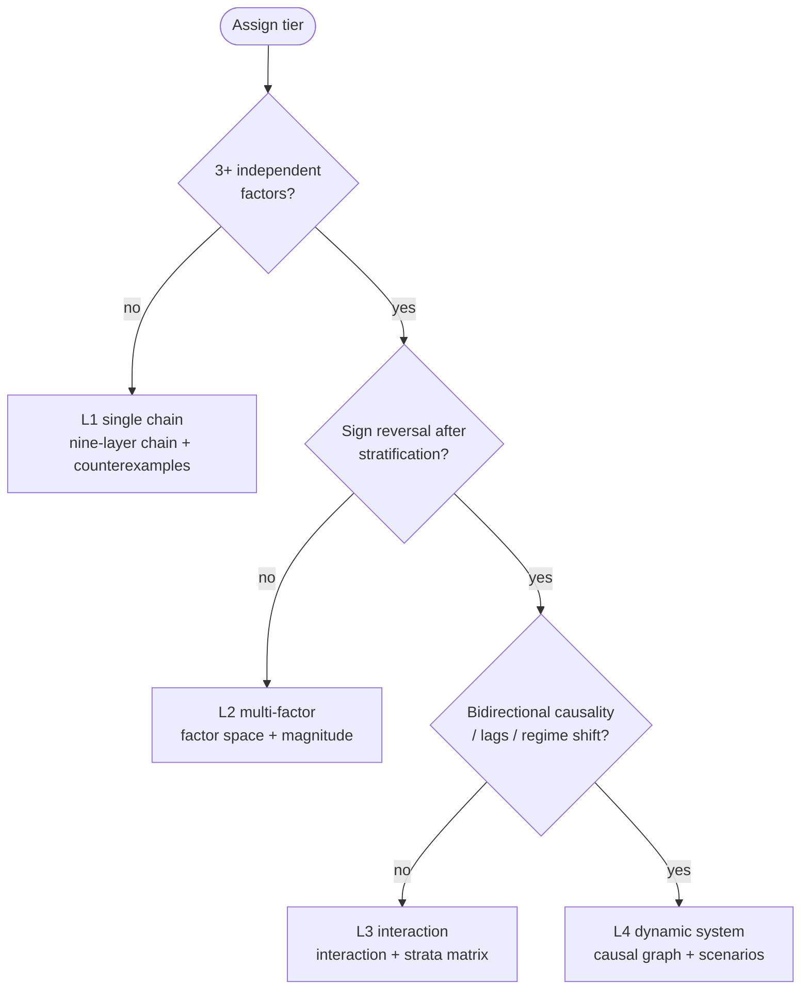
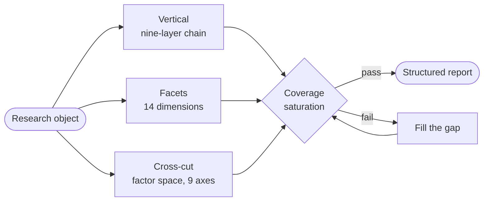
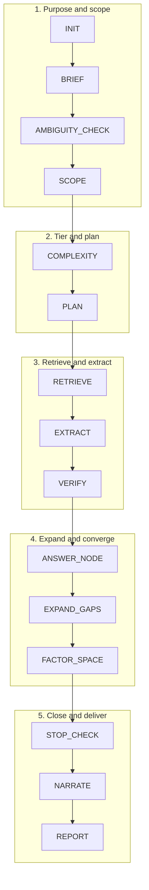

# AI-SQ Universal Root-Inquiry / Enquête radicale universelle

<p align="center">
  <a href="README.md">简体中文</a> ·
  <a href="README.en.md">English</a> ·
  <a href="README.ja.md">日本語</a> ·
  <a href="README.ko.md">한국어</a> ·
  <a href="README.es.md">Español</a> ·
  <b>Français</b> ·
  <a href="README.de.md">Deutsch</a>
</p>

<p align="center">
  <a href="https://github.com/Songyuanhong-nnn/Banana_RD-Skill/releases"></a>
  
  
  
  
</p>

> **Noyau en une phrase**
> **Enquête radicale = arbre de questions × chaîne de preuves × récursion des lacunes × espace des facteurs × portée et contre-exemples × validation des niveaux × saturation de couverture × contrôle d'arrêt × rapport structuré.**

Version **2.4.0** · Français (fr) · MIT · Texte brut, aucune dépendance d'exécution

---

## ⚖️ D'abord, ce que ce n'est pas

La v2.0 affirmait qu'il « s'applique à tous les domaines ». Cette phrase violait le 5ᵉ principe du Skill lui-même — **dès que le mot « tous » apparaît, vous êtes tenu de chercher des contre-exemples**. Les contre-exemples étaient disponibles immédiatement ; la v2.1 a donc retiré l'affirmation et l'a remplacée par un bilan honnête :

| Adéquation | Domaines | Pourquoi |
|---|---|---|
| **Forte** | Mécanismes scientifiques, choix technologiques, sources historiques | Les conclusions reposent sur la couche primaire, et **la voie de falsification est publique** (réplication, code source + mesure, critique des sources) |
| **Moyenne** | Droit, finance/affaires, politiques publiques | Fort sur les textes, les informations publiées et la recherche documentaire ; faible sur les faits propres au cas, les données internes et les contrefactuels |
| **Faible** | Décisions cliniques, pannes de systèmes privés, jeux multi-agents | Les variables de décision sont des données privées propres à cet individu ou à cette situation ; la recherche ne peut y accéder |
| **Non applicable** | Démonstration mathématique, jugement esthétique, décisions en temps réel, données non divulguées | Problèmes déductifs, aucune affirmation falsifiable, budget de temps insuffisant, preuves hors du domaine public |

Critères complets, « point le plus trompeur » de chaque domaine et voies de dégradation dans [`references/domain_fit.md`](ai-sq-universal/references/domain_fit.md).

---

## ✅ Ce qu'il garantit — et ce qu'il ne garantit pas

**Garantit** : des conclusions traçables (ID + phrase verbatim + grade) ; une portée testée (vrai pour qui, faux quand) ; des **facteurs énumérés** (pas « j'ai creusé une chaîne, je rends ma copie ») ; un arrêt motivé (il distingue « j'ai fini » de « je ne peux pas continuer »).

**Ne garantit pas** : des décisions professionnelles exécutables ; des données primaires ; des conclusions déductives ; des réponses en quelques secondes.

---

## 🧩 Cœur : pourquoi trois mécanismes de couverture

La v2.0 ne disposait que de la chaîne de neuf niveaux, une **coupe verticale** : creuser un objet vers le bas en suivant un seul fil de questions. Or les problèmes réels impliquent le plus souvent « de nombreux facteurs agissant ensemble ». Une coupe verticale peut s'achever après avoir exploré trois chaînes alors que six autres classes de facteurs n'ont jamais été envisagées.

**Profondeur ≠ couverture.** La coupe verticale a en outre un angle mort plus subtil : elle ne sait pas « ce que le client va demander ». Chaque mécanisme prend donc en charge une couche :

```
Vertical :  chaîne de neuf niveaux ───→ profond (une ligne jusqu'au fond)
Facettes :  schéma en 14 dimensions (D1–D14) → complet (les surfaces que pose le décideur)
Transversal : espace des facteurs (9 axes + magnitude) → fin (aucune classe entière de facteurs oubliée)
Strates :   matrice de stratification ─→ juste (le même facteur s'inverse selon le contexte)
Articulation : interaction et confusion (15 motifs) → réel (les facteurs ne sont pas indépendants)
Acceptation : saturation de couverture (6 critères) → vérifiable (« exhaustif » cesse d'être un adjectif)
Citation :  citation au niveau de la phrase (localisation + verbatim) → contrôlable (chaque conclusion revérifiable en 30 secondes)
```

### 1. 📐 Paliers de complexité L1–L4 : fixer le palier avant de décider de l'ampleur

| Palier | Critère structurel | Contrôles obligatoires |
|---|---|---|
| **L1 chaîne unique** | Une cause dominante → un effet principal, et les contrôles de stratification/interaction n'ont révélé aucune inversion de signe | Chaîne de neuf niveaux + contre-exemples ; pas d'espace des facteurs |
| **L2 multifactoriel** | ≥3 facteurs relativement indépendants, sans inversion de signe | Espace des facteurs + magnitude + contrôle préliminaire de colinéarité/confusion |
| **L3 interaction/hétérogénéité** | Inversion de signe après stratification, effets conjoints non additifs, seuils/non-linéarité, mécanismes différents selon les cas | L2 + matrice d'interaction + matrice de stratification |
| **L4 système dynamique** | Arêtes bidirectionnelles dans le graphe causal, preuves temporelles bidirectionnelles, décalages connus, changements de régime | L3 + graphe causal + décalages + analyse de scénarios + trois champs de limites du modèle |

Parmi les cinq règles dures, deux comptent le plus :

- **Le palier est orthogonal au nombre de facteurs** : beaucoup de facteurs mais tous linéaires = L2 ; peu de facteurs mais forte rétroaction = L4. Ne confondez pas « beaucoup de facteurs » et « complexe ».
- **Palier ≠ degré d'avancement** : le palier décide « quels contrôles sont obligatoires » ; le budget décide « combien seront faits cette fois ». Un budget insuffisant **ne fait pas baisser le palier** : marquez les éléments inachevés `unchecked`. Baisser le palier transforme silencieusement « non vérifié » en « inutile à vérifier ».

Une règle de plus contre l'auto-illusion : **« aucune inversion de signe trouvée » n'est pas « aucune inversion de signe n'existe »**. Sans contrôles de stratification/interaction, vous n'avez pas le droit d'attribuer L1/L2 : traitez-le comme un palier supérieur et laissez une trace dans `gaps`.



### 2. 🧮 Espace des facteurs : énumérer par axe, jamais de mémoire

Parcourez les neuf axes mécaniquement. Chaque axe a soit des facteurs, soit la mention « vide, motif ». Un blanc et une absence confirmée sont deux choses différentes.

| Axe | Ce qui manque le plus |
|---|---|
| Temps | Données transversales prises pour causales ; décalages invisibles |
| Espace/niveau | Erreur écologique (conclusion de groupe appliquée aux individus) |
| Agent | Ne compter que les facteurs objectifs, oublier « qui décide » |
| Matière/ressources | Traiter la contrainte de ressources comme « toutes choses égales » |
| Règles/institutions | Ignorer les changements institutionnels qui inversent les effets |
| Information/cognition | Supposer un agent pleinement informé et rationnel |
| Technologie/outils | Ignorer les différences générationnelles de technologie |
| Environnement/chocs externes | Écrire un choc ponctuel comme cause structurelle |
| Rétroaction/dynamique | Les cadres statiques ne voient pas la dynamique |

Chaque facteur doit porter `role` (nécessaire/favorisant/seuil/modificateur/confusion), `direction`, **`magnitude`**, `magnitude_basis`, `proxy` et `how_to_test`.

**La magnitude est obligatoire** : `dominant` / `major` / `minor` / `unknown` (unknown doit justifier). « Tous les facteurs ci-dessus sont importants et doivent être considérés ensemble » est interdit : cette phrase n'apporte aucune information.

### 3. 🔗 Interaction et confusion : 15 motifs à comparer activement

Voir [`references/complexity_patterns.md`](ai-sq-universal/references/complexity_patterns.md) : confusion, médiation, modification d'effet, interaction, collisionneur, paradoxe de Simpson, erreur écologique, seuil, rétroaction, décalage, dépendance au sentier, équifinalité, erreur de proxy, biais de sélection, transition de phase. Chaque entrée contient « comment le repérer / ce qu'il faut demander / indices de recherche / erreurs fréquentes ».

La sortie doit contenir `checked-none` — **sinon le lecteur ne peut distinguer « vérifié, rien trouvé » de « jamais vérifié »**.

### 4. 🎯 Saturation de couverture : rendre « exhaustif » auditable

Six critères au §14 du rapport ; s'il en manque un, vous ne pouvez pas dire « couverture systématique » :

1. **Couverture des axes** : les 9 axes parcourus, les axes vides justifiés
2. **Couverture des magnitudes** : chaque facteur a une magnitude ; unknown a un motif
3. **Saturation** : deux tours consécutifs sans nouveau facteur ni nouvel axe
4. **Espace négatif** : lister les facteurs qui « devraient exister par bon sens mais que je n'ai pas trouvés » ← **les plus grandes failles sont généralement ici**
5. **Contrôle des interactions** : les paires de facteurs dominant/major examinées
6. **Contrôle de stratification** : si ≥2 strates clés s'inversent

### 5. 🧭 Schéma des dimensions : 14 surfaces de question (la troisième couverture)

Les deux premiers mécanismes régissent « quelle profondeur atteint une question » et « quels types de facteurs produit un résultat ». Aucun ne régit « **quelles surfaces cette étude doit traiter** ». L'investisseur interroge le marché, l'ingénieur la marge de performance, les achats le TCO, le juridique les limites de conformité : s'il en manque une, le rapport est incomplet aux yeux d'une catégorie de lecteurs.

| # | Dimension | # | Dimension |
|---|---|---|---|
| D1 | Objectif et contexte de décision | D8 | Politique, réglementation, normes |
| D2 | Définitions, limites, conventions | D9 | Agents, incitations, chaîne d'achat |
| D3 | Performance et capacité technique | D10 | Temps, phases, feuille de route |
| D4 | Économie (TCO) | D11 | Risque, modes de défaillance, contre-exemples |
| D5 | Marché et demande | D12 | Qualité des preuves et controverses |
| D6 | Concurrence et pairs | D13 | Implications décisionnelles et alternatives |
| D7 | Chaîne d'approvisionnement, capacité, livraison | D14 | Questions ouvertes, espace négatif, prochaines étapes |

Chaque dimension fournit : questions obligatoires / matériel nécessaire / **difficultés typiques (les branches naissent ici)** / preuve minimale / quand déclarer unknown. Activez les dimensions obligatoires selon le type d'objet ; **toute dimension non activée doit déclarer « pourquoi elle n'est pas retenue »**.

**Quatre tours de chasse aux omissions** : R1 niveau dimension → R2 niveau facteur → R3 niveau contre-exemple (avec un passage dédié aux sortants et aux échecs) → R4 niveau espace négatif. La saturation exige deux tours consécutifs sans ajout.

Voir [`references/dimension_outline.md`](ai-sq-universal/references/dimension_outline.md).

### 6. 🔍 Citation au niveau de la phrase : la plus petite unité vérifiable de preuve

« A une source » ne suffit pas. La partie la plus ressemblante à une preuve et la moins fiable d'un rapport est la liste des références — **une citation fabriquée se lit exactement comme une vraie ; la seule différence est qu'on ne peut pas la localiser**.

Chaque conclusion clé doit fournir : **localisation** (page/paragraphe/clause/ligne de tableau/horodatage) + **phrase verbatim** + contexte + entité source et date de publication + chaîne de traçabilité.

Quatre règles dures :

1. **Doit atteindre la phrase** : un simple lien, un titre de rapport ou « une certaine page WeChat » sont automatiquement disqualifiés.
2. **Les sources secondaires sont gradées selon leur maillon le plus faible** : une page WeChat rapportant un article = gradée comme page WeChat en C/D, et **vous devez tenter de remonter à la source primaire**.
3. **Les pages WeChat ne sont que des pistes** ; les documents administratifs doivent donner **numéro de document + numéro de clause + date d'entrée en vigueur** (et leur validité actuelle vérifiée).
4. **Le contexte empêche la troncature** : que l'original soit une négation, un exemple utilisé pour réfuter, ou l'opinion d'un tiers — ces trois cas sont les plus faciles à citer comme leur contraire.

Sources sans « phrase » : les bases de données se localisent par « base + champ + période + convention » ; les entretiens/documents internes sont marqués `unverified` et n'entrent pas dans les conclusions clés ; les sources payantes ne citent que les pages réellement lues.

Voir [`schemas/citation.json`](ai-sq-universal/schemas/citation.json) et [`prompts/citation_auditor.md`](ai-sq-universal/prompts/citation_auditor.md).

---



## 🗂️ Structure du dépôt

```text
AI-SQ-Universal-Root-Inquiry/
├── README.md                  Ce fichier (chinois)
├── README.{en,ja,ko,es,fr,de}.md  Traductions
├── INSTALL.md                 Installation / vérification / dépannage / désinstallation
├── CHANGELOG.md    VERSION    LICENSE
├── ai-sq-universal/           ← Le Skill lui-même (peut aller directement dans ~/.dsh/skills/)
│   ├── SKILL.md               Spécification principale : vertical+horizontal, paliers, saturation, contrôle qualité
│   ├── prompts/               9 prompts d'exécution
│   ├── schemas/               6 contrats
│   ├── references/            5 spécifications de référence
│   ├── domain_packs/          7 paquets de domaine + notes d'adaptateur
│   ├── templates/report.md    Modèle §0 + quatorze sections (§1–§14)
│   ├── evals/cases.yaml       13 cas transversaux
│   ├── examples/              5 exemples
│   └── scripts/               validate.py  quality_gate.py  build_docx.py
├── docs/                      ← Page d'accueil GitHub Pages (chinois)
├── plugin/                    Manifeste + patch Cordis + installateurs multiplateformes
└── tools/build_release.py     Empaquetage reproductible
```

---

## 🚀 Démarrage rapide

```powershell
cd plugin
.\install.ps1                 # Windows, mode copy, aucune modification de configuration
```

```bash
cd plugin && ./install.sh     # macOS / Linux
```

Puis exposez simplement votre besoin :

> Enquête radicale sur la pathogénicité d'O157:H7 : **quels facteurs interviennent**, quelle est la force de chacun, et toutes les souches sont-elles pathogènes ?

> Même politique de restriction environnementale : pourquoi la province A s'est-elle nettement améliorée alors que la B n'a presque rien obtenu ? Décomposez les facteurs et leurs interactions.

> Creusez ce conflit de clauses : laquelle s'applique, la loi générale ou la loi spéciale, et existe-t-il des exceptions ?

Les questions avec quantificateurs sont d'abord désambiguïsées (« combien de paragraphes compte ce contrat »).

Auto-contrôle :

```bash
python ai-sq-universal/scripts/validate.py
```

---

## ⚙️ Déroulé (treize étapes)

```
INIT → BRIEF → AMBIGUITY_CHECK → SCOPE → COMPLEXITY → PLAN → RETRIEVE → EXTRACT
     → VERIFY → ANSWER_NODE → EXPAND_GAPS → FACTOR_SPACE → STOP_CHECK → NARRATE → REPORT
```

| Étape | Ce qu'elle évite |
|---|---|
| INIT | Mauvais objectif |
| **BRIEF** | **Précis mais inutile : personne ne peut agir dessus** (cinq questions de finalité + cinq classes de parties prenantes) |
| AMBIGUITY_CHECK | Répondre « combien de paragraphes » sur la mauvaise dimension |
| **SCOPE** | **Ne répondre qu'à ce qui est demandé, en omettant les variables qui décident du succès** (audit d'élargissement du périmètre) |
| **COMPLEXITY** | Surexploiter une question simple / expédier une question complexe |
| PLAN | Questions vagues |
| RETRIEVE | Prendre une encyclopédie pour une conclusion |
| EXTRACT | Force de la conclusion silencieusement gonflée (`quote` doit être verbatim) |
| VERIFY | Appliquer des catégories à des cas ; corrélation prise pour causalité |
| EXPAND_GAPS | Relance infinie (une question par lacune, ≤5, dédupliquée) |
| **FACTOR_SPACE** | **Rendre sa copie après avoir creusé une seule chaîne** |
| **STOP_CHECK** | Déguiser « pas terminé » en « terminé » |
| **NARRATE** | Des sections qui commencent par « le tableau ci-dessous montre… » sans que l'on sache la conclusion |
| REPORT | Non revérifiable |

---



## 📊 Grades de preuve (contrainte dure)

| Grade | Signification | Usage |
|---|---|---|
| **A** | Bases faisant autorité/normes/réglementation/guides/statistiques officielles + revues systématiques de haute qualité, sources concordantes | Soutient les conclusions clés |
| **B** | Recherche primaire évaluée par les pairs, rapports d'institutions faisant autorité | Soutient les conclusions |
| **C** | Préprints, rapports sectoriels, études isolées, annotation automatique | **Pistes uniquement** |
| **D** | Encyclopédies, presse, pages web non vérifiées | **Jamais pour les conclusions clés** |

Les paquets de domaine peuvent **affiner** les grades, jamais les dégrader en bloc. Sans ID, dégradation et marque `id_missing` : un ID fabriqué est pire que pas d'ID.

---

## 🛑 Règles d'arrêt

Au niveau du nœud, neuf conditions (clôture des preuves / deux tours sans information nouvelle / gain marginal faible / budget / il ne reste que C–D / conflit irréconciliable / risque élevé exigeant une revue / hors du périmètre de recherche / ambiguïté non résolue).
Global : tous les nœuds prioritaires clos **et** les six critères de couverture satisfaits, ou budget épuisé avec lacunes documentées.

**Chaque arrêt écrit un `stop_reason`.**

---

## 📄 Rapport : §0 + quatorze sections (§1–§14), livré en Word

La rédaction se fait en Markdown (les modèles le modifient facilement) ; **la livraison est en Word** (le lecteur doit l'ouvrir). `scripts/build_docx.py` convertit le même markdown en docx : couverture, sommaire, en-tête/pied, tableaux à bandes alternées, citations cliquables ; plus un JSON pour les contrôles automatiques. **Ne jamais enregistrer à la main en Word** — c'est la racine de la dérive entre le document et ses conclusions. Depuis la v2.4, le rapport s'ouvre sur **§0 Finalité et parties prenantes** et ajoute le §14 Déclaration de couverture et de saturation : sans lui, « exhaustif » n'est qu'un adjectif.

Modèle dans `templates/report.md` ; exemple rempli dans [`examples/01-bacteriology.md`](ai-sq-universal/examples/01-bacteriology.md) (avec tableau d'espace des facteurs et déclaration honnête de « couverture incomplète »).

---

## 🚦 Contrôle qualité

```bash
python ai-sq-universal/scripts/quality_gate.py report.md --json report.json --complexity 3 --risk high
```

Les contrôles s'intensifient avec la complexité : L2 vérifie facteurs et magnitudes ; L3 vérifie interactions/strates/`checked-none` ; L4 vérifie rétroaction et limites du modèle. Il vérifie aussi les quatorze sections, le taux de traçabilité, **le taux de localisations de citation analysables**, **la colonne de phrases verbatim**, **l'interception des attributions vagues**, **l'interdiction de grader les médias A/B**, les registres de vérification par échantillonnage, le langage absolu, les motifs d'arrêt, les avertissements et l'espace négatif. Sortie PASS/FAIL avec code de sortie, intégrable en CI.

---

## 🧪 Évaluation

13 cas couvrant science, droit, finance, histoire, technologie, politique, affaires, objets ambigus, questions sans réponse et questions à haut risque, dont **deux cas L3 multifactoriels difficiles** (même politique, résultats opposés dans deux régions ; même souche, issues différentes) et un **cas difficile de citation au niveau de la phrase** (vérifier un chiffre secondaire d'une page WeChat et remonter à la source primaire). Chaque cas porte `probes` / `must_show` / `must_not` / `expected_stop` / `complexity` ; toute correspondance `must_not` vaut zéro.

---

## 🏛️ Principes de conception (douze)

1. Noyau agnostique au domaine + paquets adaptateurs : le noyau ne code en dur aucun terme de domaine
2. **Fixer le palier de complexité avant la profondeur** : évite le formalisme et la négligence
3. **Vertical pour la profondeur, horizontal pour la couverture** : chaîne de neuf niveaux + espace des facteurs, les deux requis
4. Guidé par les lacunes : ne poursuivre que les lacunes d'information, ne jamais répéter une question
5. Preuve d'abord : les conclusions clés exigent source, phrase verbatim, ID et grade
6. Bornage du périmètre : global/classe/instance/condition/temps/géographie
7. Contrôle des contre-exemples : dès que « tous/tout/toujours/unique » apparaît, chercher des contre-exemples
8. Validation des niveaux : ne pas prendre un porteur pour un élément, un produit pour une cause, une propriété de catégorie pour une propriété d'instance
9. Désambiguïser d'abord : clarifier ou déclarer les hypothèses
10. **Couverture auditable** : six critères ; s'il en manque un, dire « couverture incomplète »
11. Revue humaine en cas de risque élevé : médecine/droit/finance/sécurité/politique/psychologie
12. Double sortie : JSON + Markdown

---

## ⚠️ Modes d'échec et contre-mesures

| Mode d'échec | Contre-mesure |
|---|---|
| Relance infinie | Budget + clé de déduplication + arrêt sur gain marginal |
| **Creuser une seule chaîne** | Paliers de complexité + espace des facteurs + énumération par axe |
| **Liste de facteurs indifférenciée** | `magnitude` + `magnitude_basis` obligatoires |
| **Effets moyens masquant des sous-groupes inverses** | Matrice de stratification + modification d'effet |
| **Corrélation prise pour causalité** | Contrôles de confusion/médiation/collisionneur |
| **Fausse exhaustivité** | Six critères du §14 + espace négatif |
| IDs fabriqués | Dégradation sans ID ; jamais deviner un ID |
| Conclusions de catégorie appliquées aux cas | `scope` + contre-exemples |
| Confusion porteur/élément/produit | Validation `entity_levels` |
| Mauvaise réponse à « combien de paragraphes » | Désambiguïsation `structure_semantics` |
| Uniquement des pages web | Priorité des sources + grades de preuve |
| Conflits lissés | Préserver le désaccord, inclure un tableau des conflits |
| Désinformation à haut risque | Avertissement + revue humaine |

---

## 🚧 Limites

- Ne traite pas les cours, la météo ni les scores en temps réel.
- Ne remplace pas le jugement professionnel : les sorties en médecine/droit/finance sont une **organisation de l'information**, pas un diagnostic, un conseil juridique ou une recommandation d'investissement.
- Ne fournit pas de détails exécutables utilisables pour nuire réellement (amélioration de pathogènes, évasion de détection, weaponisation, etc.).
- **« Non trouvé » ≠ « n'existe pas »** : le rapport distingue les deux.
- Problèmes déductifs (démonstration mathématique, dérivation de code), jugement esthétique, expérimentation primaire, données internes : non adapté. Voir `references/domain_fit.md`.

---

## 📚 Documentation

- [INSTALL.md](INSTALL.md) — installation / vérification / dépannage / désinstallation
- [ai-sq-universal/SKILL.md](ai-sq-universal/SKILL.md) — spécification principale complète
- [references/domain_fit.md](ai-sq-universal/references/domain_fit.md) — faut-il seulement l'utiliser
- [references/complexity_patterns.md](ai-sq-universal/references/complexity_patterns.md) — aide-mémoire des motifs multifactoriels
- [domain_packs/README.md](ai-sq-universal/domain_packs/README.md) — ajouter un paquet de domaine
- [plugin/README.md](plugin/README.md) — couche plugin et routage d'installation
- [CHANGELOG.md](CHANGELOG.md) — historique des versions
